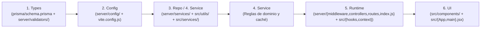
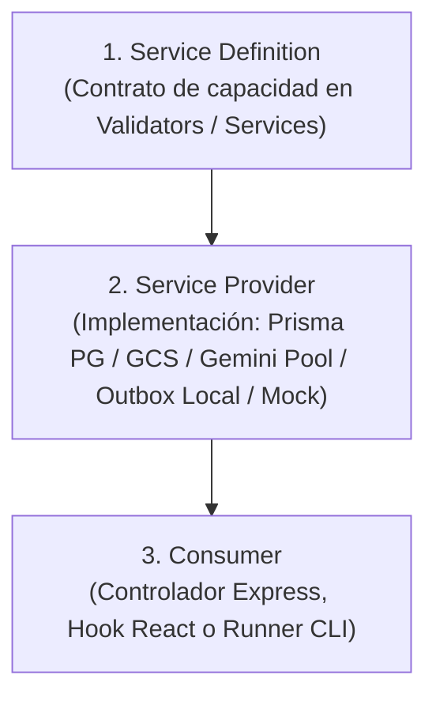

# ARCHITECTURE.md

Este documento es el mapa arquitectónico superior de **STAND {IA} (`deko-eventsales`)** para Deco Vintage Guate y Deko Labs. Define los 9 dominios reales de negocio más los subsistemas de gobernanza del arnés, mapea las **6 capas estrictas** sobre las carpetas reales de producción (`src/` y `server/` sin renombrar rutas activas) y documenta las fronteras impuestas mecánicamente por `scripts/check-architecture.sh` y `scripts/audit-harness.js`.

## 1. Forma General del Sistema

- **Proyecto / Flujo de Trabajo:** Plataforma Fullstack en producción **STAND {IA} (`deko-eventsales`)** — React 18 + Vite 5 + TailwindCSS (`src/`), API Express 5 + Node ESM + Zod (`server/`), PostgreSQL + Prisma 6 (`prisma/schema.prisma`), Google Cloud Storage y Google Gemini 3/4 Multimodal (`@google/genai`).
- **Flujo Principal del Sistema:** Gestiona ventas omnicanal por eventos feriales, mostrador con cola offline y redes sociales (cotizador 50/50, taller de pliegos y cierres contables), gobernado por **3 Puertas en orden estricto** (`init.sh`: Estática -> Comportamiento `100/100` -> Sistema Completo) unificadas con los candados físicos de Deko Labs (`npm run harness:check`).
- **Superficies de Ejecución:** Frontend SPA (`src/`), servidor HTTP/SSE (`server/index.js`), compuertas POSIX/Node (`init.sh`, `scripts/check-architecture.sh`, `scripts/validate-harness.mjs`, `scripts/audit-harness.js`, `scripts/harness-hooks.mjs`) y contenedor Docker/Dokploy (`Dockerfile`, `entrypoint.sh`).
- **Fuente de Verdad del Comportamiento:** `prisma/schema.prisma`, `feature_list.json`, `sprint-contract.md`, `ARCHITECTURE.md` y suites deterministas en `tests/`.

## 2. Mapa de Dominios

| Dominio (Área) | Propósito (De qué es dueño) | Carpeta / Punto de Entrada | Especificación Relacionada |
| :--- | :--- | :--- | :--- |
| **1. Auth Multi-Tenant y Roles (`auth`)** | Sesiones JWT, aislamiento por usuario/rol (`SUPER_ADMIN`, `VENDEDOR_MOSTRADOR`, `VENDEDOR_REDES`, `OPERARIO`) y asignaciones a eventos | `src/context/AuthContext.jsx`, `server/controllers/authController.js`, `server/controllers/userController.js` | `tests/security/zero-trust.test.js`, `docs/SECURITY.md` |
| **2. Eventos Feriales y Gastos (`events`)** | Alta de eventos simultáneos, stands activos, registro de gastos operativos y rentabilidad por evento | `server/services/eventFinanceService.js`, `server/controllers/eventController.js` | `tests/adversarial/surgery-053-multi-event-radar-contracts.test.js` |
| **3. Catálogo de Pósters y Sync Web (`catalog`)** | Caché local indexada, búsqueda difusa/etiquetas, deduplicación y webhook de sincronización web | `src/services/catalogCacheService.js`, `server/services/catalog/`, `server/controllers/catalogController.js`, `server/controllers/catalogWebhookController.js` | `tests/catalog/` |
| **4. POS Mostrador y Cola Offline (`pos`)** | Venta rápida táctil, combos promocionales, idempotencia de secuencias y sincronización de bandeja offline (`outbox`) | `src/components/FastManualSaleForm.jsx`, `src/services/offlineSalesOutbox.js`, `server/services/sales/`, `server/controllers/saleController.js` | `tests/sales/` |
| **5. Ventas Redes / Cotizador 50-50 / Logística (`remote-sales`)** | Pedidos digitales personalizados, anticipo 50% / liquidación 50%, comprobantes en GCS y guías de envío | `server/services/sales/remoteSaleService.js` | `tests/adversarial/surgery-056-permanent-pos-and-pickup-accounting.test.js` |
| **6. Asistente Multimodal STAND {IA} Voz VAD + Visión + SSE (`ai-copilot`)** | Copiloto conversacional con detección de actividad de voz (VAD), búsqueda visual/semántica en catálogo y streaming SSE con pool de llaves Gemini | `src/components/UnifiedAiChat.jsx`, `server/services/ai/`, `server/services/semantic/`, `server/controllers/ai/` | `scripts/verify-gemini-models.js`, `tests/ai/` |
| **7. Taller y Pliegos de Impresión (`production`)** | Cola de producción, armado de pliegos de impresión, reposiciones de stock y estados de manufactura | `server/services/productionService.js`, `server/services/printSheetService.js` | `prisma/schema.prisma` |
| **8. Cierre de Caja y Monitor Financiero (`finance-closing`)** | Arqueo diario por vendedor/método de pago, cierre automático de medianoche y KPIs horarios en vivo | `server/services/sales/cashClosingService.js`, `server/services/sales/midnightClosingService.js`, `server/services/sales/monitorKpiService.js`, `server/controllers/cashClosingController.js` | `tests/adversarial/surgery-058-accounting-transparency-and-breakdown.test.js` |
| **9. Liquidaciones y Comisiones 20% neto (`commissions`)** | Cálculo auditado de comisiones netas (20% descontando costos/envíos aplicables) y liquidación a vendedores | `server/services/commissionService.js` | `prisma/schema.prisma` |
| **Gobernanza, Estado, Memoria y Verificación (`harness`)** | Índice `AGENTS.md` (`100L`), `WIP <= 1`, Auto-Memoria en dos pasos, 3 Puertas (`init.sh`), linter dual de capas, hooks `Fail-Closed` (`<= 280L`) y candados Deko Labs | `AGENTS.md`, `feature_list.json`, `sprint-contract.md`, `loop-state.md`, `progress.md`, `session-handoff.md`, `memory/INDEX.md`, `init.sh`, `scripts/check-architecture.sh`, `scripts/validate-harness.mjs`, `scripts/audit-harness.js`, `scripts/harness-hooks.mjs`, `.agents/hooks.json` | `docs/GOTCHAS.md`, `docs/QUALITY_SCORE.md` |

## 3. Modelo Estricto de Capas (Flujo Direccional Único — Adaptación Brownfield)

El repositorio mapea sus carpetas reales de producción (`src/` y `server/`) sobre el flujo direccional canónico de **6 capas**, sin renombrar directorios activos en producción:

`Types (Definiciones) -> Config (Ajustes) -> Repo (Datos/Archivos) -> Service (Lógica de Negocio) -> Runtime (Ejecución) -> UI (Interfaz/Salida)`

### Equivalencia Real de las 6 Capas en `deko-eventsales`

| Capa | Responsabilidad | Equivalencia Real en Producción (`server/` y `src/`) | Artefactos del Arnés |
| :--- | :--- | :--- | :--- |
| **1. `Types`** | Esquema relacional, contratos de validación Zod e interfaces puras sin dependencias superiores | `prisma/schema.prisma` + `server/validators/` | `scripts/feature-list.schema.json`, esquema de `feature_list.json`, `GraphState` en `graph.md` |
| **2. `Config`** | Variables de entorno validadas con Zod (`env.js`), clientes base (`prisma.js`, `gcs.js`, `gemini.js`) y build Vite | `server/config/` + `vite.config.js` | `.gitignore`, `.gitattributes`, `AGENTS.md`, `ARCHITECTURE.md`, `docs/SECURITY.md`, `.agents/hooks.json`, `goal.md` |
| **3. `Repo`** | Persistencia Prisma/GCS, caché local (`IndexedDB`/`localStorage`), cola offline y lectura/escritura de archivos | `server/services/` (acceso a datos) + `src/services/` (`catalogCacheService.js`, `offlineSalesOutbox.js`) | Funciones I/O (`readText`, `readJson`, `writeText`, `loadHarnessFiles`) en `scripts/lib/harness-utils.mjs` |
| **4. `Service`** | Reglas puras de negocio (finanzas de evento, cotizador 50/50, comisiones 20%, pliegos, búsqueda semántica) y utilidades puras | `server/services/` y `src/utils/` + `src/services/` | Funciones puras (`scoreHarness`, `validateFeatureListObject`) en `scripts/lib/harness-utils.mjs` |
| **5. `Runtime`** | Middlewares Express, controladores HTTP/SSE, ruteadores, bootstrap del servidor y hooks/contextos React | `server/middleware/`, `server/controllers/`, `server/routes/`, `server/index.js` y `src/hooks/` + `src/context/` | `init.sh`, `scripts/check-architecture.sh`, `scripts/validate-harness.mjs`, `scripts/audit-harness.js`, `scripts/harness-hooks.mjs` |
| **6. `UI`** | Vistas React táctiles de mostrador, cotizador, taller, monitor financiero, chat multimodal y entrada SPA | `src/components/`, `src/App.jsx`, `src/main.jsx` | Formateadores (`formatScoreReport`, `htmlReport`) en `scripts/lib/harness-utils.mjs` y salida Bolígrafo Rojo |

### Reglas Duras de Dependencia (Invariantes Impuestas por `scripts/check-architecture.sh`)

1. **Aislamiento Fullstack (`0 tolerancia` `src/` <-> `server/`)**: Está terminantemente prohibido cualquier `import` o `require` relativo/interno entre `src/` y `server/`. La comunicación ocurre exclusivamente vía contratos HTTP/JSON y SSE.
2. **Orden Direccional Estricto en Frontend (`src/`, `0` violaciones)**: `utils (1) -> services (2) -> hooks (3) -> context (4) -> components (5) -> App.jsx / main.jsx (6)`. Ninguna capa inferior puede importar de una capa superior.
3. **Orden Direccional Estricto en Backend (`server/`) y Prohibición de Salto `Controller -> Config`**: `validators (1) -> config (2) -> services (3) -> middleware (4) -> controllers (5) -> routes (6) -> index.js (7)`. Ninguna capa inferior puede importar de una superior y ningún controlador nuevo en `server/controllers/` puede saltar `server/services/` para importar directamente `server/config/*`. Las únicas **13 tuplas heredadas** previas al arnés quedan congeladas en `LEGACY_SERVER_ALLOWLIST` (prohibido agregar una 14.ª).
4. **Prohibido ir hacia atrás en librerías del arnés**: `scripts/lib/*.mjs` (`Repo`/`Service`) nunca importa de `Runtime` (`validate-harness.mjs`, `harness-hooks.mjs`) ni ejecuta `process.exit`.
5. **Justificación de dependencias nuevas y preocupaciones transversales**: Toda dependencia NPM nueva debe justificarse en `sprint-contract.md`; seguridad, secretos, modelos Gemini y observabilidad entran únicamente por las fronteras de la sección 5.
6. **Validación en 3 Puertas + Candados Deko Labs**: `init.sh` y `npm run harness:check` verifican estática (`check-architecture.sh`, `audit-secrets.js`, `verify-gemini-models.js`), comportamiento (`validate-harness.mjs --min-score 100`) y sistema completo (`test` + `vite build`) con errores en formato **Bolígrafo Rojo** (`ERROR:` + `POR QUÉ:` + `SOLUCIÓN (FIX):`).

## 4. Capability Seams (Costuras de Capacidad Intercambiables — DeepSeek Harness)

Cada integración externa se modela como un **`Capability Seam`** de tres roles para desacoplar la lógica comercial del proveedor concreto:

- **`Service Definition`**: Contratos de almacenamiento de medios, generación/visión IA, persistencia transaccional de ventas y ejecución de hooks.
- **`Service Provider`**: Proveedores concretos intercambiables (`Google Cloud Storage` vs almacenamiento estático de prueba, `aiKeyPoolService` sobre `@google/genai`, `offlineSalesOutbox` en navegador, o sandboxes en `os.tmpdir()`).
- **`Consumer`**: Controladores HTTP/SSE y componentes React que consumen el servicio uniforme sin acoplarse a credenciales ni detalles de transporte.

## 5. Interfaces Transversales (Cross-Cutting Interfaces)

| Preocupación | Límite / Adaptador Aprobado | Notas e Invariantes |
| :--- | :--- | :--- |
| **Logging y trazabilidad** | Esquema de `docs/RELIABILITY.md` + middlewares de observabilidad en `server/middleware/` | Trazabilidad con `correlationId`, latencia medida y cero exposición de tokens o PII en logs. |
| **Autenticación, secretos y BD** | `docs/SECURITY.md` + `server/config/env.js` (Zod) + `scripts/audit-secrets.js` + `scripts/harness-hooks.mjs` | Cero lectura/escritura de `.env` por agentes, cero correos personales/IP de VPS en código y bloqueo `PreToolUse` de comandos Prisma destructivos (`migrate reset`, `--force-reset`, `--accept-data-loss`). |
| **Modelos Gemini y APIs externas** | `server/config/gemini.js`, `server/services/ai/aiKeyPoolService.js` y `scripts/verify-gemini-models.js` | Protocolo Zero-Memory (solo modelos vigentes Gemini 3/4), rotación resiliente de llaves, *timeouts* explícitos y políticas `Fail-Closed`. |
| **Despliegue e integridad pre-push** | `scripts/audit-harness.js` (`STAND-IA-UNIFIED-HARNESS`) invocado por `.git/hooks/pre-push` y `scripts/deploy-dokploy.js` | Bloquea cualquier despliegue si falla arquitectura, puntaje `100/100`, secretos, sintaxis, modelos IA, suite Zero-Trust, unit tests o `vite build`. |

## 6. Puntos Calientes Actuales (Current Hotspots)

1. **Módulos de alta densidad de negocio**: `entityAliases.js` (`server/services/semantic/`), `eventController.js` (`server/controllers/eventController.js`), `remoteSaleService.js` (`server/services/sales/remoteSaleService.js`) y `App.jsx` (`src/App.jsx`) concentran reglas críticas multi-evento y omnicanal; cualquier cambio futuro requiere pruebas de regresión focalizadas antes de editar.
2. **Archivos duplicados latentes heredados (no tocar fuera de alcance explícito)**: coexisten `server/services/webCatalogService.js` frente a `server/services/catalog/webCatalogService.js`, y `src/utils/imageCompression.js` frente a `src/utils/imageCompressor.js`. Antes de consolidarlos en una tarea futura dedicada, deben auditarse todos sus importadores reales.
3. **`LEGACY_SERVER_ALLOWLIST` congelada de 13 tuplas (`scripts/check-architecture.sh`)**: congela exactamente 1 dependencia heredada `config -> services` (`server/config/gemini.js->server/services/ai/aiKeyPoolService.js`) y 12 accesos directos heredados `controllers -> config` (`env.js` / `prisma.js`). Está prohibido ampliar este conjunto; al refactorizar un controlador en el futuro, debe eliminarse su tupla correspondiente del `Set`.
4. **Compuertas deterministas y Hooks nativos**: `init.sh`, `scripts/check-architecture.sh`, `scripts/audit-harness.js`, `.agents/hooks.json` y `scripts/harness-hooks.mjs` (`<= 280L`) gobiernan `PreToolUse`, `PostToolUse` y `Stop`; todo cambio exige mantener `0 CRLF` y validar en memoria sobre `os.tmpdir()` (`< 2s`).

## 7. Lista de Verificación al Modificar la Arquitectura

1. Actualiza `ARCHITECTURE.md` si cambian dominios, equivalencias de las 6 capas, `Capability Seams`, puntos calientes o si se reduce `LEGACY_SERVER_ALLOWLIST`.
2. Registra el contexto y las alternativas descartadas (`Alternatives considered`) en `progress.md`.
3. Refleja cualquier nuevo invariante mecánico con formato Bolígrafo Rojo en `scripts/check-architecture.sh` y actualízalo en `docs/QUALITY_SCORE.md`.
