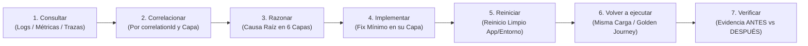

# RELIABILITY.md (Observabilidad de Runtime, Fiabilidad en 3 Puertas y Validación UI)

Este documento define cómo el sistema demuestra de forma determinista que está saludable, es observable desde señales locales y permanece reiniciable (`restartable`), eliminando las suposiciones y los reintentos a ciegas (*blind retries*) tanto en backend/CLI como en interfaces de usuario.

---

## 1. Las 4 Rutas Estándar y Señales Requeridas en Tiempo de Ejecución

Todo proyecto gobernado por este arnés expone cuatro rutas operativas canónicas que cualquier sesión nueva puede ejecutar sin configuración manual:

| Ruta Estándar | Comando / Procedimiento Canónico | Propósito Operativo |
| :--- | :--- | :--- |
| **1. Arranque (`Startup`)** | `bash ./init.sh` | Confirma directorio, integridad de artefactos críticos, sincronización multi-stack y salud de línea base antes de tocar código. |
| **2. Verificación (`Verification`)** | `bash ./init.sh` (`bash scripts/check-architecture.sh` + `node scripts/validate-harness.mjs --min-score 100`) | Ejecuta secuencialmente las 3 Puertas (Estática, Comportamiento `100/100` y Sistema Completo: build, lint, type-check y tests). |
| **3. Iniciar aplicación o servicio (`Start app / service`)** | `RUN_START_COMMAND=1 bash ./init.sh` (o `START_CMD` configurado en el entorno/proyecto) | Levanta la aplicación o servicio objetivo únicamente después de haber superado las 3 puertas de verificación previas. |
| **4. Depurar o inspeccionar runtime (`Debug / inspect runtime`)** | Filtrado local de trazas JSON por `correlationId` / `level: "error"` + ejecución aislada de la puerta o recorrido afectado | Permite diagnosticar la causa raíz y la capa propietaria del fallo desde señales locales antes de modificar código. |

### Señales Requeridas en Tiempo de Ejecución (`Required Runtime Signals`)
Está estrictamente prohibido emitir mensajes vagos como `"Algo salió mal"`, `"Error procesando archivo"` o `"Fallo inesperado"`. El runtime debe proporcionar cuatro señales observables:
1. **Logs estructurados** para el arranque y todos los flujos críticos (siguiendo `RuntimeLogEntry`).
2. **Verificaciones de salud (`health checks`)** para servicios clave, dependencias locales y estado de inicialización.
3. **Datos de traza o tiempo (`durationMs`, latencia por etapa, conteos de fallos o profundidad de cola)** para rutas lentas o flujos de múltiples pasos.
4. **Estados de error visibles y accionables para el usuario** ante fallos recuperables (con secretos, tokens y PII redactados según `docs/SECURITY.md`).

---

## 2. Esquema Obligatorio de Logs JSON Estructurados (`RuntimeLogEntry`)

Cada paso crítico de ejecución en módulos de runtime o automatización debe registrar un **objeto JSON estructurado** con los siguientes 8 campos obligatorios:

| Campo | Tipo | Obligatorio | Descripción y Propósito |
| :--- | :--- | :--- | :--- |
| `timestamp` | `string` (ISO 8601) | Sí | Fecha y hora exacta en UTC (ej. `"2026-10-28T19:10:00.000Z"`). |
| `level` | `"info" \| "warn" \| "error"` | Sí | Nivel de severidad del evento. |
| `component` | `string` | Sí | Pieza o módulo del sistema que emite el evento (ej. `"ArchitectureChecker"`, `"HarnessValidator"`, `"IngestaDocumentos"`). |
| `action` | `string` | Sí | Operación específica en curso (ej. `"verificar_6_capas"`, `"evaluar_subsistemas"`, `"extraer_texto"`). |
| `durationMs` | `number` | Sí | Tiempo de ejecución en milisegundos para detectar cuellos de botella y regresiones de latencia. |
| `input` | `object \| string` | Sí | Resumen sanitizado de los parámetros de entrada (sin secretos, credenciales ni payloads masivos). |
| `output` / `error` | `object \| null` | Sí | Resultado estructurado en caso de éxito (`output`) o detalle exacto del fallo (`error` con `message`, `why` y `fix`). |
| `correlationId` | `string` | Sí | Identificador único por solicitud o corrida (ej. `"req-8f2a1c"`) que permite rastrear de principio a fin todos los pasos de una misma operación a través de las 6 capas. |

### Ejemplo Canónico: Evento Exitoso (`level: "info"`)

```json
{
  "timestamp": "2026-10-28T19:10:04.120Z",
  "level": "info",
  "component": "HarnessValidator",
  "action": "evaluar_5_subsistemas",
  "durationMs": 42,
  "input": {
    "rootDir": ".",
    "minScore": 100
  },
  "output": {
    "overallScore": 100,
    "passedChecks": 25,
    "totalChecks": 25,
    "cleanState": true
  },
  "error": null,
  "correlationId": "req-8f2a1c"
}
```

### Ejemplo Canónico: Evento de Fallo con Bolígrafo Rojo (`level: "error"`)

```json
{
  "timestamp": "2026-10-28T19:10:05.305Z",
  "level": "error",
  "component": "ArchitectureChecker",
  "action": "verificar_flujo_direccional_capas",
  "durationMs": 18,
  "input": {
    "targetFile": "scripts/lib/harness-utils.mjs"
  },
  "output": null,
  "error": {
    "message": "Violación de capa en 'scripts/lib/harness-utils.mjs': invocación prohibida a 'process.exit('.",
    "why": "La Regla Dura #1 de ARCHITECTURE.md prohíbe que Repo/Service dependa o controle el ciclo de vida de Runtime.",
    "fix": "Elimina 'process.exit(' de 'scripts/lib/harness-utils.mjs' y devuelve un objeto de resultado para que la capa Runtime decida el código de salida."
  },
  "correlationId": "req-8f2a1c"
}
```

---

## 3. Contrato de Fiabilidad en 3 Puertas (`init.sh`) y Recorridos Dorados (`Golden Journeys`)

Ningún cambio en el repositorio se considera fiable hasta superar secuencialmente las **3 Puertas de Verificación** ejecutadas por `bash ./init.sh` bajo modo estricto POSIX (`set -euo pipefail`):

1. **Puerta 1 — Estática y Límites Arquitectónicos (`Static & Architecture Gate`)**:
   - Comprueba la existencia física de los archivos vitales del arnés y ejecuta `bash scripts/check-architecture.sh` para validar `ARCHITECTURE.md`, las 6 capas (`Types -> Config -> Repo -> Service -> Runtime -> UI`), los límites de Auto-Memoria (`memory/INDEX.md <= 200` líneas / `25 KB` e Invariante de Dos Pasos), la integridad de Observabilidad Dual, cero enlaces muertos en `Required Artifacts` y el escáner `cleanup-scanner`.
2. **Puerta 2 — Comportamiento y Reglas de Subsistemas (`Behavioral Gate`)**:
   - Ejecuta `node scripts/validate-harness.mjs --min-score 100` exigiendo `100/100` en los 5 subsistemas (`instructions`, `state`, `verification`, `scope`, `lifecycle`), validando `WIP <= 1`, orden secuencial DAG (incluyendo bloqueo aguas abajo ante estado `blocked`) sobre las tareas del proyecto (`N >= 1` en `feature_list.json`) y `Pass-State Gating`.
3. **Puerta 3 — Sistema Completo (`End-to-End System Gate`)**:
   - Sincroniza dependencias y ejecuta build, lint, type-check y tests mediante autodetección multi-stack (`pnpm`/`yarn`/`bun`/`npm`, Python, Go, Rust, Maven, Gradle, .NET) o `INSTALL_CMD` / `VERIFY_CMD`, confirmando `CLEAN STATE`.

### Recorridos Dorados (`Golden Journeys`)
Cada recorrido dorado define un flujo crítico de extremo a extremo con una ruta de verificación repetible y señales inequívocas de éxito y de fallo:

| ID | Recorrido Dorado (`Golden Journey`) | Ruta de Verificación Repetible | Señal de Éxito Esperada | Señal Clara de Fallo |
| :--- | :--- | :--- | :--- | :--- |
| **`GJ-01`** | **Arranque en frío y salud integral en 3 puertas** | `bash ./init.sh` | Código `0`, `Overall: 100/100` (`25/25 PASS`) y cierre `CLEAN STATE`. | Parada inmediata (`Exit != 0`) con bloque `ERROR + POR QUÉ + SOLUCIÓN`. |
| **`GJ-02`** | **Transición de tarea bajo `WIP = 1`, DAG y `Pass-State Gating`** | `node scripts/validate-harness.mjs --min-score 100` + `bash scripts/check-architecture.sh` | Máximo 1 tarea `in-progress`, dependencias en `done`, `required_files` con tamaño `> 0` y `evidence` no vacío al cerrar. | Caída de puntaje `< 100/100` o violación de esquema JSON si falta `evidence` o un archivo físico. |
| **`GJ-03`** | **Entrega limpia y reinicio entre sesiones (`Clean Handoff`)** | Revisión de `progress.md` + `session-handoff.md` + `bash ./init.sh` en sesión nueva | Cero temporales (`*.tmp`, `*.swp`, `WIP.md`, `*.log` en `src/`) y marcadores de reinicio completos. | Alerta de `cleanup-scanner` en Puerta 1 o ambigüedad sobre el siguiente paso. |
| **`GJ-APP`** | **Flujos críticos de usuario del producto (`src/`)** | Comandos E2E / integración del dominio (registrar aquí al implementar cada flujo de producto) | Respuesta válida, `RuntimeLogEntry` limpio con `correlationId` y estado final persistido tras reiniciar. | Excepción en logs estructurados, regresión de latencia o pérdida de estado tras reinicio. |

---

## 4. Bucle de Depuración de Observabilidad en 7 Pasos (`SOP observability-feedback-loop`)

Cuando ocurre un fallo en tiempo de ejecución o el comportamiento real diverge del esperado, el agente debe operar sobre un **stack mínimo consultable localmente** (logs JSON estructurados, métricas de latencia/conteos de fallos y trazas cuando apliquen, recopilados localmente junto a una carga de trabajo repetible) y seguir estrictamente este bucle de **7 pasos**:



1. **Consultar (`query`)**: Inspeccionar la salida real de la puerta fallida, los logs JSON locales (`level: "error"`) y los tiempos (`durationMs`).
2. **Correlacionar (`correlate`)**: Agrupar todos los eventos de la operación mediante `correlationId` para localizar el punto exacto donde se corrompió el estado.
3. **Razonar (`reason`)**: Identificar qué capa (`Types -> Config -> Repo -> Service -> Runtime -> UI`) es propietaria del defecto antes de tocar ningún archivo.
4. **Implementar (`implement`)**: Aplicar la corrección mínima en la capa responsable sin debilitar validadores ni desbordar el alcance (`WIP = 1`).
5. **Reiniciar (`restart`)**: Reiniciar limpiamente el servicio, worker o entorno afectado para descartar estado residual en memoria.
6. **Volver a ejecutar (`re-run`)**: Correr exactamente la misma carga de trabajo o Recorrido Dorado que disparó el fallo, además de `bash ./init.sh`.
7. **Verificar (`verify`)**: Confirmar con evidencia ejecutable que la señal de fallo desapareció, el sistema reinicia limpio y no surgieron regresiones.

### Lista de Verificación de Sesión de Depuración y Reglas de Fiabilidad
Antes de dar por resuelto un incidente de runtime, el agente debe poder responder con evidencia local:
- **¿Qué falló?** y **¿qué señal local prueba el fallo?**
- **¿Qué capa es propietaria del fallo?** y **¿qué cambió exactamente después de la corrección?**
- **¿La aplicación se reinició limpiamente?** y **¿la misma carga de trabajo pasó tras volver a ejecutar?**

**Invariantes Permanentes de Fiabilidad:**
- **Fallo Rápido (`Fail-Fast`) y Cero Reintentos a Ciegas**: Prohibido re-ejecutar un comando fallido sin haber leído antes el diagnóstico y corregido la causa.
- **Reiniciabilidad obligatoria**: Ninguna característica está completa si el sistema no puede reiniciarse limpiamente después (`clean-state` es parte de la fiabilidad, no una tarea separada).
- **Barrera ante fallos repetidos**: Si un modo de fallo reaparece, promuévelo a prueba automatizada, benchmark o regla mecánica en `scripts/check-architecture.sh`.

---

## 5. Validación de UI / Frontend y Bucle con Chrome DevTools (Activable para Proyectos con UI)

Cuando el proyecto incluya interfaz gráfica (web, móvil o escritorio en `src/ui/`), la inspección estática del código es insuficiente. Todo trabajo de UI debe cumplir estas barreras de protección (y cuando la superficie visual crezca, codificar las convenciones específicas del proyecto en `docs/FRONTEND.md` y los tokens/componentes en `docs/references/design-system-reference-llms.txt` según la Expansión Progresiva de `AGENTS.md`):

### Principios de UI y los 5 Estados Visibles Clave
- **Claridad y consistencia**: Priorizar claridad antes que novedad, flujos descubribles y reiniciables, pocos componentes reutilizables frente a variantes de un solo uso, y consistencia en textos, navegación por teclado y jerarquía visual.
- **Accesibilidad (`a11y`) como verificación normal**: Semántica DOM, etiquetas accesibles, foco visible, uso completo por teclado y contraste forman parte de la verificación estándar de cada entrega, nunca de un pulido opcional posterior.
- **Cobertura obligatoria de los 5 estados visibles para el usuario**: Toda vista o interacción asíncrona debe especificar y verificar explícitamente:
  1. **`vacío` (`empty`)**: Estado inicial comprensible cuando aún no existen registros o resultados.
  2. **`cargando` (`loading`)**: Retroalimentación visual inmediata con bloqueo de envíos duplicados.
  3. **`éxito` (`success`)**: Renderizado fiel de los datos confirmados y transición predecible.
  4. **`error` (`error`)**: Mensaje claro y sanitizado ante fallos recuperables (prohibidos los fallos silenciosos).
  5. **`reintento` (`retry`)**: Mecanismo directo para reintentar la acción fallida sin perder contexto ni recargar forzosamente.
- **Regla anti-regresión de UI**: Siempre que se corrija un defecto visual o de interacción, se debe agregar o actualizar el paso de validación correspondiente.

### Bucle Principal de Validación con Chrome DevTools (8 Pasos `ANTES / DESPUÉS`)
Con un comando de inicio estable (`START_CMD`), un recorrido reproducible y criterios observables de éxito (texto presente, botón habilitado, solicitud HTTP exitosa, consola limpia), el agente debe ejecutar este bucle hasta que el recorrido quede limpio:

1. **Seleccionar la página objetivo** o instancia activa de la aplicación.
2. **Limpiar el ruido obsoleto de la consola** antes de comenzar la prueba.
3. **Capturar el estado `ANTES`** (instantánea del DOM, captura de pantalla y estado base de red/consola).
4. **Disparar exactamente una ruta de UI** a la vez para aislar causa y efecto.
5. **Observar los eventos en tiempo de ejecución** durante la interacción (mensajes de consola, peticiones de red y cambios en el DOM).
6. **Capturar el estado `DESPUÉS`** (redactando cualquier token, clave API o PII en capturas y logs).
7. **Aplicar la corrección en la capa responsable más pequeña** (`Types -> Config -> Repo -> Service -> Runtime -> UI`) y **reiniciar la aplicación** si el cambio lo requiere.
8. **Volver a ejecutar la validación** sobre la misma ruta comparando `ANTES` vs. `DESPUÉS` hasta cumplir los **4 criterios de limpieza**: (a) el estado visible intencionado está presente, (b) no hay errores inesperados, (c) el ruido de consola fue eliminado o explicado, y (d) repetir la ruta produce idéntico resultado; actualizando entonces el plan activo, `docs/RELIABILITY.md` (si pasa a ser Recorrido Dorado) y `docs/product-specs/` (si cambió el comportamiento visible).
