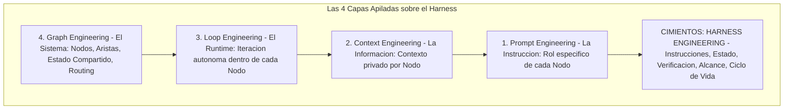
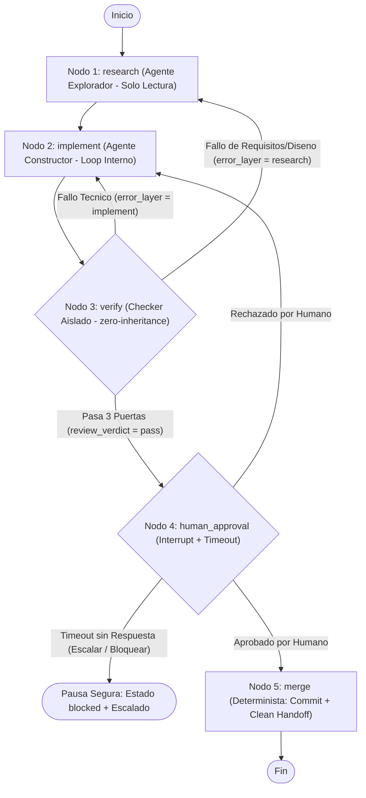

# graph.md (Especificación de Ingeniería de Grafos y Coordinación Multi-Agente)

Este documento define la cuarta capa de la Ingeniería de IA (**Graph Engineering**) sobre nuestro arnés. Establece cuándo un loop único debe escalar a un grafo explícito de nodos aislados, qué preguntas de diseño deben responderse antes de dibujarlo, por qué un grafo generaliza a un workflow, cómo se fusionan escrituras paralelas (`Fan-out / Fan-in` con *State Reducers* y `git worktree`), y cómo operan las aristas de retroceso y las aprobaciones humanas (`Interrupt` + `Timeout`).

---

## 1. Las 4 Capas Apiladas sobre el Harness

Ninguna capa reemplaza a la anterior; cada una envuelve a la inferior metiéndola dentro de sus propios nodos, y todas descansan sobre los cimientos del **Harness**:

1. **Prompt Engineering**: Da forma a la *instrucción* ("qué decirle al modelo").
2. **Context Engineering**: Da forma a la *información* ("qué sabe el modelo antes de decidir": `Write-Select-Compress-Isolate`).
3. **Loop Engineering**: Da forma al *runtime iterativo* ("cómo itera autónomamente con un Disyuntor de 4 Candados hasta alcanzar un objetivo").
4. **Graph Engineering**: Da forma al *sistema completo* ("cómo colaboran múltiples agentes especializados con contextos privados, herramientas deterministas, evaluadores y aprobaciones humanas").



---

## 2. Fallos del Loop Único, las 4 Preguntas de Eigent, `Graph ≠ Workflow` y la Crítica de `iii.dev`

Cuando un único bucle cerrado opera a escala sin separación estructural, sufre tres patologías inevitables:
1. **Ley de Goodhart**: El loop optimiza el indicador proxy superficial en lugar del resultado real de ingeniería o negocio.
2. **Ceguera hacia Arriba**: Un loop nunca cuestiona *"¿Sigue siendo correcto este requisito o diseño?"*; solo itera ciegamente intentando forzar una premisa equivocada.
3. **Conflicto entre Loops**: Un bucle que optimiza velocidad o volumen sabotea al bucle que optimiza calidad arquitectónica o seguridad.

### 2.1 Las 4 Preguntas Obligatorias de Diseño de Eigent y las Anclas (`Anchors`)
Antes de dibujar cualquier grafo (si no puedes responderlas, no lo dibujes), responde estas cuatro preguntas estructurales:
1. **¿Qué loops alimentan a qué loops?** (`research` alimenta especificaciones a `implement`; `implement` entrega artefactos verificables a `verify`; `verify` habilita `human_approval` y `merge`).
2. **¿Qué loops poseen los objetivos que otros loops persiguen?** (El contrato humano en `goal.md`, `feature_list.json` y `sprint-contract.md` posee el objetivo; `implement` nunca redefine su propia meta).
3. **¿Qué loops pueden vetar o revertir un cambio?** (`verify` bajo `zero-inheritance` y `human_approval` poseen poder de veto y reversión hacia `implement` o `research`).
4. **¿Qué indicadores pueden moverse y cuáles deben congelarse?** (Pueden moverse el progreso de tareas y el avance del *Ratchet*; permanecen **congelados** `Overall: 100/100`, `WIP <= 1`, las 6 capas y los archivos `Hands off`).

**Anclas (`Anchors`)**: Por sofisticada que sea la red de loops, sin anclas al mundo real deriva en resonancia mutua. Nuestras anclas innegociables son `bash ./init.sh` (ejecución real en 3 puertas), la auditoría aislada `zero-inheritance` y la compuerta humana.

### 2.2 Distinción `Graph ≠ Workflow` (Anthropic) y la Advertencia de `iii.dev`
Un grafo y un workflow tradicional comparten el esqueleto (`nodos + aristas + estado compartido + routing`), pero difieren en **quién decide el control de flujo** y **qué vive dentro del nodo**:
- **Workflow tradicional**: Todos sus nodos son funciones deterministas y sus aristas son código estático (`if / switch`). Es el caso particular 100% determinista de un grafo.
- **Grafo (`Graph Engineering` como generalización del Workflow)**: Contenedor mixto donde coexisten **nodos de workflow deterministas** (`merge`, suites de test), **nodos de agente completos con su propio loop interno privado** (`research`, `implement`, `verify`) y **nodos humanos (`Interrupt`)** (`human_approval`), conectados mediante routing dinámico basado en el resultado de verificación.

> [!IMPORTANT]
> **La Voz Contraria (`iii.dev` — *La Topología NO es un Muro de Carga*)**
> *"La forma es la parte fácil, y es desechable. Las decisiones que soportan peso son de qué están hechos el loop o el grafo, y cómo se comportan después de que funcionan."*
> No conviertas dibujar nodos en un logro en sí mismo: la topología puede cambiar mañana, pero lo que soporta peso real de ingeniería es **reproducibilidad** (reproducir cualquier fallo localmente), **observabilidad** (`correlationId` en `docs/RELIABILITY.md` y trazabilidad por paso) y **recuperación** (continuar desde el último checkpoint en disco tras una caída).

---

## 3. Diseño del Grafo en 6 Pasos (`5-Node Workflow Graph`)

### Paso 1 — Estado Compartido (`GraphState`) y Estrategias de Fusión (`State Reducers`)
En la capa del grafo **solo se comparte la mesa de estado**; la ventana de contexto conversacional de cada nodo es estrictamente privada. Para evitar condiciones de carrera cuando corren ramas paralelas, cada campo declara su **`State Reducer`** (*cómo se fusionan escrituras concurrentes*: `overwrite`, `append` o `sum`):

```json
{
  "thread_id": "sesion-001-feat-001",
  "active_feature": "feat-001",
  "requirements": "Especificación extraída por research desde ARCHITECTURE.md, sprint-contract.md y docs/product-specs/ (cuando exista)",
  "code_or_deliverable": ["docs/RELIABILITY.md", "graph.md"],
  "parallel_branches": [],
  "error_layer": null,
  "review_verdict": "pass",
  "approval_status": "approved",
  "attempts": 1
}
```

| Campo de `GraphState` | Tipo / Valores Permitidos | Nodo Escritor | Estrategia de Fusión (`Reducer`) | Propósito en el Grafo |
| :--- | :--- | :--- | :--- | :--- |
| `requirements` | `string` | `research` | `overwrite` (único escritor por fase) | Requisitos exactos extraídos de `ARCHITECTURE.md`, `sprint-contract.md` y `docs/product-specs/` (cuando exista). |
| `code_or_deliverable` | `string[]` | `implement` | `append` (unión disjunta sin duplicados) | Lista de archivos creados o modificados verificables físicamente en disco. |
| `parallel_branches` | `object[]` | `fan-out` / `fan-in` | `append` (registro por rama / `worktree`) | Estado individual, ruta de `git worktree` y veredicto de cada sub-tarea paralela cuando aplica `Fan-out`. |
| `error_layer` | `"research" \| "implement" \| null` | `verify` | `overwrite` | Capa donde nació el fallo: `"research"` (premisa/requisito mal planteado) o `"implement"` (defecto técnico de ejecución). |
| `review_verdict` | `"pass" \| "fail"` | `verify` | `overwrite` (`ALL PASS` tras `fan-in`) | Veredicto objetivo tras ejecutar las 3 puertas (`bash ./init.sh`) y `evaluator-rubric.md`. |
| `approval_status` | `"pending" \| "approved" \| "rejected" \| "timeout_escalated"` | `human_approval` | `overwrite` | Resolución explícita del humano o disparo determinista de `Timeout` / escalado. |
| `attempts` | `number` (`max: 15`) | `verify` / `implement` | `sum` (`operator.add`, `+1` por fallo) | Contador acumulativo gobernado por el Disyuntor de 4 Candados de `goal.md`. |

### Paso 2 — Los 5 Nodos Especializados
Cada nodo opera bajo permisos mínimos (`Fail-Closed`):

1. **Nodo 1: `research` (Agente Explorador — Solo Lectura)**:
   - **Herramientas permitidas**: Exclusivamente lectura y búsqueda (`read_file`, `grep`, `glob`). Prohibida cualquier escritura en código.
   - **Responsabilidad**: Ejecuta lectura quirúrgica de `ARCHITECTURE.md`, `sprint-contract.md` y `docs/product-specs/` (cuando exista), y escribe `requirements`.
2. **Nodo 2: `implement` (Agente Constructor — *Maker* con Loop Interno)**:
   - **Herramientas permitidas**: Lectura, escritura dentro de `Fair game` y autoverificación local (`maker-prompt.md`).
   - **Responsabilidad**: Ejecuta su micro-loop interno privado (*escribir -> probar -> corregir*), construye los entregables físicos y actualiza `code_or_deliverable`.
3. **Nodo 3: `verify` (Agente Evaluador Independiente — *Checker* con `zero-inheritance`)**:
   - **Herramientas permitidas**: Lectura y ejecución real de `bash ./init.sh`, `bash scripts/check-architecture.sh` y `node scripts/validate-harness.mjs --min-score 100`.
   - **Responsabilidad**: **Ventana de contexto completamente nueva** (jamás hereda el razonamiento de `implement`). Audita con `checker-prompt.md` y `evaluator-rubric.md`, escribiendo `review_verdict` y `error_layer`.
4. **Nodo 4: `human_approval` (*Human-in-the-Loop* / Compuerta de Interrupción Humana)**:
   - **Naturaleza**: Punto de interrupción humano (`Interrupt`) con formato estandarizado y regla `Fail-Closed` de `Timeout` (ver Paso 5).
5. **Nodo 5: `merge` (Código Determinista — Sin IA)**:
   - **Naturaleza**: Procedimiento determinista de cierre.
   - **Responsabilidad**: Tras `review_verdict == "pass"` (`11-12/12`) y `approval_status == "approved"`, actualiza `feature_list.json` (`done` + `evidence`), `progress.md` (`WIP = 0`) y `session-handoff.md`, valida `clean-state-checklist.md` y ejecuta `git commit`.

### Paso 3 y Paso 4 — Aristas Explícitas, Routing por `error_layer` y Aristas Antes Implícitas
El flujo nominal recorre `Inicio -> research -> implement -> verify -> human_approval -> merge -> Fin`, mientras las aristas condicionales exponen en el plano decisiones que en un agente monolítico quedaban **ocultas implícitamente en su conversación** (como volver a investigar cuando los tests pasan pero se malinterpretó el requisito, o bloquear ante silencio humano):

- **Ruta A (`review_verdict == "fail"` y `error_layer == "implement"`)**: Retrocede de `verify` a `implement` (`attempts += 1`) para corregir defectos técnicos sin repetir `research`.
- **Ruta B — Arista Implícita Hecha Explícita (`review_verdict == "fail"` y `error_layer == "research"`)**: Incluso si las pruebas unitarias pasan, si `verify` detecta un malentendido de requisitos o límites arquitectónicos, retrocede **directamente de `verify` a `research`**.
- **Ruta C (`review_verdict == "pass"`)**: Avanza de `verify` al interruptor `human_approval`.
- **Ruta D (Resolución o `Timeout` en `human_approval`)**: `"approved"` avanza a `merge`; `"rejected"` retrocede a `implement` (o `research` si cambia el alcance); `"timeout_escalated"` detiene la rama en estado seguro (`blocked`) y escala sin fusionar jamás por omisión.



### Paso 5 — Checkpoints en Disco, Formato del `Interrupt` Humano y Regla de `Timeout`
El estado compartido se persiste en disco al concluir cada nodo (`feature_list.json`, `sprint-contract.md`, `loop-state.md`, `progress.md`, `session-handoff.md`), permitiendo reanudar desde el punto exacto de ruptura. Al llegar a `human_approval`, el grafo se pausa emitiendo una solicitud con **formato obligatorio de 4 bloques**:

1. **Qué pasó y qué cambió**: Tarea activa, resumen del cambio y lista exacta de archivos en `code_or_deliverable`.
2. **Evidencia verificada**: Salidas reales de `bash ./init.sh`, `Overall: 100/100` y desglose `0-12` de `evaluator-rubric.md`.
3. **Por qué se necesita decisión humana**: Motivo específico del `Interrupt` (cambio estructural, frontera externa o cierre de entregable crítico).
4. **Consecuencias de aprobar o rechazar**: `"aprobar"` ejecuta `merge` y consolida el commit; `"rechazar"` revierte/devuelve al nodo origen según `error_layer`.

**Regla Determinista de `Timeout` / Escalado (`Fail-Closed`)**: Si no se registra respuesta humana tras `N` horas configuradas (por defecto `24h`), está prohibido asumir aprobación implícita: el nodo registra `approval_status = "timeout_escalated"`, preserva el checkpoint limpio en disco, marca bloqueo/escalado en `session-handoff.md` y espera intervención explícita.

### Paso 6 — Ejecución con `thread_id` y Reglas de `Fan-out / Fan-in` con `git worktree`
Cada corrida recibe un `thread_id` único correlacionado con `correlationId` (`docs/RELIABILITY.md`). Cuando un nodo admite paralelismo real (por ejemplo, implementar dos módulos sin solapamiento o dividir `verify` entre *tests + lint* y *revisión arquitectónica*), debe cumplir estas cuatro reglas de **`Fan-out / Fan-in`**:

1. **Regla de `Fan-out` (División Explícita)**: Registrar en `parallel_branches` las `N` sub-tareas independientes, otorgando a cada rama su propia ventana de contexto privada y propiedad disjunta de archivos (*disjoint file ownership*).
2. **Aislamiento Físico con `git worktree`**: Toda rama paralela que escriba o compile código debe ejecutarse en un **`git worktree` separado**, eliminando físicamente colisiones de edición, artefactos temporales cruzados o bloqueos de índice.
3. **Regla de `Fan-in` (Criterio de Fusión)**: Un único nodo coordinador/fusionador aplica los `State Reducers` (`append` para entregables disjuntos, `sum` para `attempts`) bajo criterio estricto de conjunción **`ALL PASS`**: solo se fusionan los `worktrees` si **todas** las ramas requeridas superan las 3 Puertas sin violar alcance.
4. **Medición Empírica del Paralelismo**: Registrar tiempo *wall-clock*, tokens consumidos y calidad antes y después del `Fan-out` para comprobar que el ahorro real supera el *overhead* de coordinación y merge.

---

## 4. Los 3 Patrones de Delegación Multi-Agente

Cuando un nodo coordina múltiples agentes, debe elegir exclusivamente uno de estos **3 patrones arquitectónicos** y respetar su Regla de Oro:

| Patrón | Cómo Comparten Contexto | Cuándo Usarlo | Regla de Oro Inquebrantable |
| :--- | :--- | :--- | :--- |
| **1. `Coordinator` (Coordinador)** | **Cero herencia (`zero-inheritance`)**: Los trabajadores inician con ventana limpia y solo reciben el prompt autocontenido redactado por el Coordinador. | Flujos multi-fase (`research -> implement -> verify`), como nuestra auditoría `Maker-Checker`. | **Sintetizar, nunca delegar la comprensión**: Prohibido decir *"Basado en tus hallazgos, arréglalo"*. El Coordinador lee los hallazgos primero y redacta una especificación exacta y autocontenida. |
| **2. `Fork` (Bifurcación Paralela)** | **Herencia completa de prefijo**: Los hijos heredan el contexto ya cargado del padre para dividir trabajo rápido en paralelo reutilizando la `Prompt Cache`. | Dividir 2 o 3 sub-tareas independientes que necesitan exactamente el mismo contexto base ya leído. | **Estrictamente 1 solo nivel con bloqueo *at call time* (`Gotcha #8`)**: Un hijo creado por `Fork` tiene prohibido volver a hacer `Fork`; la herramienta `fork` **se mantiene en el pool de definiciones del hijo** para no invalidar la `Prompt Cache` compartida con el padre, pero el runtime **bloquea su ejecución en tiempo de llamada (*at call time*)**. |
| **3. `Swarm` (Enjambre Plano)** | **Pizarra compartida**: Un equipo fijo de especialistas toma tareas independientes de una cola común (`feature_list.json`). | Trabajo prolongado con ramas independientes en paralelo en el DAG. | **Plantilla plana (`Flat Roster`)**: Ningún agente del equipo puede crear sub-agentes adicionales por su cuenta, y cada miembro opera con *disjoint file ownership* en su propio `git worktree`. |

---

## 5. Cuándo SÍ y Cuándo NO Dibujar un Grafo (El Impuesto de Orquestación)

> **Advertencia sobre el Impuesto de Orquestación (`Orchestration Tax` — Addy Osmani)**:
> *"Tú eres el GIL de tus agentes de IA. Arrancar 5 agentes en paralelo es gratis; revisar y fusionar lo que hicieron 5 agentes es carísimo, porque tu juicio es el único procesador en serie."*

"Complejo" no significa "muchos pasos": un pipeline lineal de 20 pasos sin desvíos necesita un script o checklist, no un grafo. **Solo construye un grafo si cumples al menos 3 de estos 5 criterios**:

1. [ ] **Independencia real de unidades**: La tarea puede dividirse en partes con *disjoint file ownership* aislables en `git worktree`.
2. [ ] **Ramificación o retroceso diferenciado**: Existen rutas condicionales reales (volver a `research` vs. volver a `implement` según `error_layer`).
3. [ ] **Valor de los Checkpoints**: El coste de ejecución justifica persistir estado en disco por nodo para interrumpir y reanudar sin empezar de cero.
4. [ ] **Aceptación automática por nodo**: Cada nodo cuenta con un criterio verificable mecánicamente (`bash ./init.sh`, `evaluator-rubric.md`).
5. [ ] **Beneficio de colaboración > Coste de coordinación**: El tiempo o calidad ganados superan el *Orchestration Tax* de coordinar y fusionar salidas.
